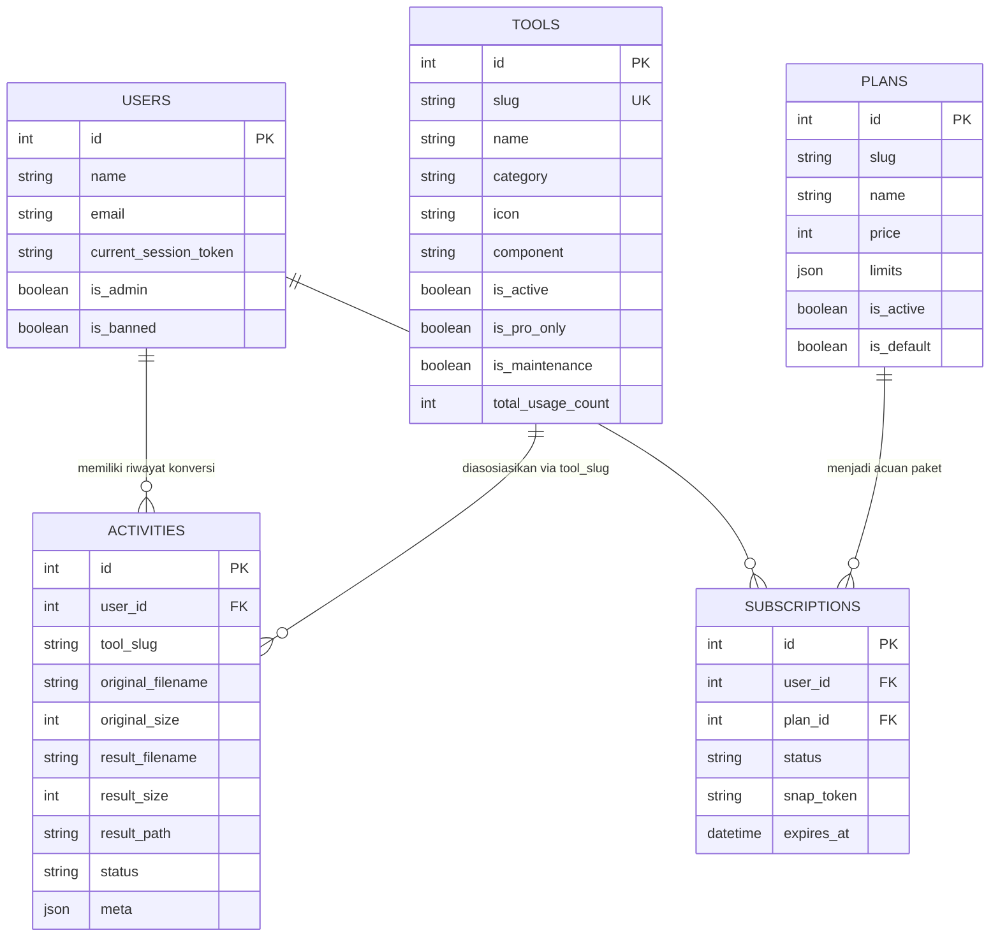

# 🧠 Peta Jaringan Arsitektur ToolBox (System Architecture Map)

Dokumen ini merupakan representasi mental model jaringan sistem aplikasi ToolBox. Didesain agar agen AI manapun yang membaca repositori ini dapat memahami topologi utuh sistem secara instan.

---

## 1. Topologi Jaringan Komponen Utama

```mermaid
graph TD
    User["Pengguna Web (Browser)"]
    Vite["Vite Asset Compiler (Tailwind v4)"]
    Livewire["Livewire 4.3 Component (Class-Based)"]
    Blade["Blade View (Lineone UI Kit)"]
    Entitlements["EntitlementService (Limit & Kuota)"]
    ActivityLog["Activity Model (Status & Audit)"]
    ToolService["Tool Processing Service"]
    PyRunner["Symfony Process Runner"]
    PyScript["Python CLI Engine (PyMuPDF / pdf2docx / dll)"]
    LibreOffice["LibreOffice Headless (soffice.com)"]
    LocalStorage["Local Disk (storage/app/private/users/)"]
    CleanupCmd["Scheduler (cleanup:temp)"]

    User -->|HTTP Request| Livewire
    Livewire -->|Render UI| Blade
    Blade -->|Interaksi & Upload| Livewire
    Livewire -->|Cek Kuota & Fitur| Entitlements
    Livewire -->|Catat Mulai (processing)| ActivityLog
    Livewire -->|Delegasikan Tugas| ToolService
    ToolService -->|Eksekusi Skrip| PyRunner
    PyRunner -->|Panggil Skrip CLI| PyScript
    PyScript -.->|Konversi Office / PDF| LibreOffice
    PyScript -->|Tulis Berkas Output| LocalStorage
    ToolService -->|Update Hasil (completed/failed)| ActivityLog
    LocalStorage -.->|Dibersihkan setelah 24 jam| CleanupCmd
```

---

## 2. Katalog 14+ Alat (Tools) & Mesin Pemroses

| Slug Alat | Kategori | Livewire Component | PHP Service | Mesin Pemroses Utama |
|---|---|---|---|---|
| `compress-image` | Image | `Tools\ImageCompressor` | `ImageProcessorService` | Intervention Image v4 (GD) |
| `convert-image` | Image | `Tools\ImageConverter` | `ImageProcessorService` | Intervention Image v4 (GD) |
| `pdf-to-word` | Document | `Tools\PdfToWord` | `PdfConverterService` | `storage/scripts/pdf2word.py` (`pdf2docx` via Queue) |
| `compress-pdf` | Document | `Tools\PdfCompressor` | `PdfCompressorService` | `storage/scripts/compress_pdf.py` (`PyMuPDF`) |
| `word-to-pdf` | Document | `Tools\WordToPdf` | `WordToPdfService` | `storage/scripts/word2pdf.py` (LibreOffice Headless) |
| `pdf-to-powerpoint` | Document | `Tools\PdfToPowerpoint` | `PdfToPowerpointService`| `storage/scripts/pdf2pptx.py` (`python-pptx`, `PyMuPDF`) |
| `powerpoint-to-pdf` | Document | `Tools\PowerpointToPdf` | `PowerpointToPdfService`| `storage/scripts/pptx2pdf.py` (LibreOffice Headless) |
| `pdf-to-excel` | Document | `Tools\PdfToExcel` | `PdfToExcelService` | `storage/scripts/pdf2xlsx.py` (`openpyxl`, `PyMuPDF`) |
| `excel-to-pdf` | Document | `Tools\ExcelToPdf` | `ExcelToPdfService` | `storage/scripts/xlsx2pdf.py` (LibreOffice Headless) |
| `merge-pdf` | Document | `Tools\MergePdf` | `MergePdfService` | `storage/scripts/merge_pdf.py` (`PyMuPDF`) |
| `split-pdf` | Document | `Tools\SplitPdf` | `SplitPdfService` | `storage/scripts/split_pdf.py` (`PyMuPDF`) |
| `pdf-to-jpg` | Document | `Tools\PdfToJpg` | `PdfToJpgService` | `storage/scripts/pdf2jpg.py` (`PyMuPDF`) |
| `jpg-to-pdf` | Document | `Tools\JpgToPdf` | `JpgToPdfService` | `storage/scripts/jpg2pdf.py` (`PyMuPDF` / `Pillow`) |
| `edit-pdf` | Document | `Tools\EditPdf` | `EditPdfService` | `storage/scripts/edit_pdf.py` (`PyMuPDF`) |
| `rotate-pdf` | Document | `Tools\RotatePdf` | `RotatePdfService` | `storage/scripts/rotate_pdf.py` (`PyMuPDF`) |
| `protect-pdf` | Document | `Tools\ProtectPdf` | `ProtectPdfService` | `storage/scripts/protect_pdf.py` (`PyMuPDF` AES-256) |
| `unlock-pdf` | Document | `Tools\UnlockPdf` | `UnlockPdfService` | `storage/scripts/unlock_pdf.py` (`PyMuPDF`) |
| `watermark-pdf` | Document | `Tools\WatermarkPdf` | `WatermarkPdfService` | `storage/scripts/watermark_pdf.py` (`PyMuPDF` / `Pillow`) |
| `resize-image` | Image | `Tools\ResizeImage` | `ResizeImageService` | Intervention Image v4 (GD Driver) |
| `crop-image` | Image | `Tools\CropImage` | `CropImageService` | Intervention Image v4 (GD Driver) |
| `qr-generator` | Utility | `Tools\QrGenerator` | `QrGeneratorService` | `chillerlan/php-qrcode` (v6.0) + Intervention Image v4 |
| `word-counter` | Utility | `Tools\WordCounter` | `WordCounterService` | PHP Multibyte String (`mb_string` + Regex UTF-8) |
| `page-number-pdf` | Document | `Tools\PageNumberPdf` | `PageNumberPdfService` | `storage/scripts/page_number_pdf.py` (`PyMuPDF`) |

---

## 3. Matriks Relasi Data & Entitas



---

## 4. Jaminan Ketahanan Sistem (Fail-safes & Guardrails)
1. **Pencegahan Akun Ganda (Single Session)**: Token sesi tunggal `current_session_token` dicek pada setiap request melalui `EnsureSingleSession`.
2. **Pencegahan Berkas Tertinggal (Disk Leak)**: Berkas sementara dibersihkan setiap jam via scheduler `CleanupTempFiles`.
3. **Pencegahan Crash Server pada File Besar**: Timeout Symfony Process disetel bervariasi antara 60 hingga 300 detik. Eksekusi berat dialihkan ke queue database.
4. **Isolasi Concurrency LibreOffice**: Pemanggilan LibreOffice menyertakan profil sementara unik `-env:UserInstallation=file:///...` sehingga konversi multi-user tidak saling mengunci.
